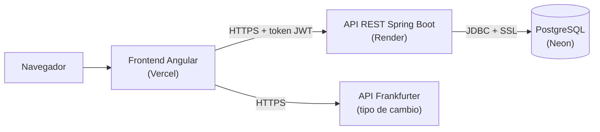

# GAMS Finanzas — Frontend

Aplicación web de finanzas personales para jóvenes y universitarios: registra tus ingresos y gastos, conoce
tu saldo al instante y consulta el tipo de cambio. Proyecto del curso **Desarrollo Full Stack** — Universidad
Tecnológica del Perú (UTP).

- **Backend (API REST):** <https://github.com/DiegoPorrasZela/GAMS-Finanzas-backend>
- **Cuenta de prueba:** `demo@gams.pe` / `demo123`

## Funcionalidades

- **Cuentas de usuario:** registro, inicio y cierre de sesión. La sesión dura 8 horas (token JWT).
- **Inicio (resumen del mes):** saldo total, ingresos y gastos del mes elegido, gráfico de gastos por
  categoría ("¿en qué se va tu dinero?") y últimos movimientos.
- **Mi presupuesto:** defines cuánto quieres gastar como máximo y cuánto ahorrar cada mes. Una barra muestra
  lo gastado, avisa al pasar el 80 % o el límite, y calcula cuánto puedes gastar por día lo que queda del mes.
- **Metas de ahorro:** objetivos como "Laptop, S/ 2500 para junio". Registras aportes, ves el porcentaje
  avanzado y cuánto ahorrar al mes para llegar a tiempo.
- **Movimientos:** registrar, editar, eliminar, filtrar por mes, tipo o categoría y buscar.
- **Tipo de cambio:** conversión entre más de 160 monedas con historial y gráfico, usando la API pública
  [Frankfurter](https://frankfurter.dev).
- **Administración** (solo rol ADMIN): crear, editar y eliminar categorías, y gestionar las cuentas de usuario.

## Tecnologías

- Angular 22 (componentes standalone, signals, formularios reactivos)
- Tailwind CSS 4
- TypeScript y Vitest para las pruebas

## Arquitectura



El frontend nunca habla con la base de datos: todo pasa por el API, que valida la sesión y los permisos.

```
frontend/src/
├── app/
│   ├── components/     Componentes reutilizables (gráfico de tasas)
│   ├── guards/         Protegen las rutas según la sesión y el rol
│   ├── interceptors/   Agregan el token JWT a cada petición al backend
│   ├── models/         Tipos de datos (Movimiento, Categoria, Usuario)
│   ├── pages/          Pantallas: inicio, movimientos, metas, tipo-cambio, admin, login, registro, acerca
│   ├── services/       Comunicación con el API y estado de la sesión
│   └── utils/          Ayudas para fechas y meses
└── environments/       URL del API en desarrollo y en producción
```

### Rutas y permisos

| Ruta | Acceso |
|---|---|
| `/login`, `/registro` | Solo sin sesión |
| `/` (Inicio), `/movimientos`, `/metas` | Con sesión |
| `/admin` | Solo ADMIN |
| `/tipo-cambio`, `/acerca` | Público |

Los guards solo mejoran la experiencia (no muestran pantallas que no corresponden). La seguridad real está
en el backend, que rechaza cualquier petición sin permiso aunque alguien salte el frontend.

### Patrones de diseño

| Patrón | Dónde se usa | Para qué |
|---|---|---|
| Singleton + inyección de dependencias | Servicios con `providedIn: 'root'` e `inject()` | Una sola instancia compartida por toda la app |
| Observer | `signal`/`computed` y Observables de RxJS | La pantalla se actualiza sola cuando cambian los datos |
| Chain of Responsibility | `interceptors/auth.interceptor.ts` | Cada petición pasa por el interceptor: agrega el token y maneja la sesión vencida (401) |
| Guard | `guards/auth.guards.ts` | Decidir si se puede entrar a una ruta |
| Adapter | Funciones `desdeApi()` de los servicios | Convertir el formato del API (`INGRESO`) al de la app (`ingreso`) |

## Cómo ejecutar

Requisitos: [Node.js](https://nodejs.org) 22.22 o superior y el
[backend](https://github.com/DiegoPorrasZela/GAMS-Finanzas-backend) corriendo en `http://localhost:8080`.

```bash
cd frontend
npm install
npm start
```

Abrir <http://localhost:4200>.

La URL del API está en `src/environments/environment.development.ts` (desarrollo) y
`src/environments/environment.ts` (producción).

Pruebas: `npm test`
