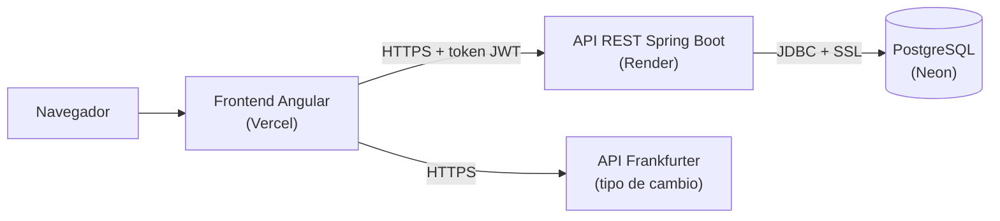

# GAMS Finanzas — Frontend

Aplicación web de finanzas personales para jóvenes y universitarios: registra tus ingresos y gastos, conoce
tu saldo al instante y consulta el tipo de cambio. Proyecto del curso **Desarrollo Full Stack** — Universidad
Tecnológica del Perú (UTP).

- **Backend (API REST):** <https://github.com/DiegoPorrasZela/GAMS-Finanzas-backend>
- **Cuenta de prueba:** `demo@gams.pe` / `demo123`

## Funcionalidades

- **Cuentas de usuario:** registro, inicio y cierre de sesión. La sesión dura 8 horas (token JWT).
- **Inicio (resumen del mes):** saldo total, ingresos y gastos del mes elegido, gastos por categoría ("¿en qué
  se va tu dinero?"), últimos movimientos y un gráfico de **ingresos contra gastos de los últimos 6 meses**
  (con detalle al pasar el mouse o con el teclado, y la opción "Ver como tabla").
- **Mi presupuesto:** defines cuánto quieres gastar como máximo y cuánto ahorrar cada mes. Una barra muestra
  lo gastado, avisa al pasar el 80 % o el límite, y calcula cuánto puedes gastar por día lo que queda del mes.
- **Ahorros y metas:** separas dinero de tu saldo a tus ahorros (una vez, o cada día, semana o mes) y desde
  ahí lo repartes a metas como "Laptop, S/ 2500 para junio": ves el porcentaje avanzado y cuánto ahorrar al
  mes para llegar a tiempo. Si hay una emergencia, puedes retirar de tus ahorros. El ahorro se ve en
  Movimientos pero no cuenta como gasto.
- **Movimientos:** registrar, editar, eliminar, filtrar por mes, tipo o categoría y buscar. No se aceptan
  fechas futuras, y si un gasto deja el saldo en negativo la app avisa antes de guardarlo.
  - **Agrupados por día** ("Hoy", "Ayer", "Lunes, 3 de noviembre") con cuánto cambió el saldo ese día, y de a
    30 con "Ver más".
  - **Cada categoría con su ícono y color** (Comida naranja, Transporte azul…), elegidos por el administrador.
  - **Gastos en dólares o euros:** se escribe el monto en la moneda en que se pagó y la app lo convierte a
    soles con el tipo de cambio de ese día (Frankfurter). Se guardan los dos montos.
  - **Eliminar con "Deshacer":** el movimiento desaparece al instante y durante 5 segundos se puede
    recuperar; recién entonces se borra en el servidor.
  - **Descargar Excel (CSV):** exporta lo que se ve con los filtros actuales.
- **Movimientos automáticos:** al registrar el sueldo, el alquiler o un plan, se marca "Repetir
  automáticamente" (cada día, semana, quincena —el 15 y fin de mes— o mes, eligiendo el día o "último día del
  mes") y la app lo registra sola, ajustándose a meses de 28, 29, 30 o 31 días. Se pueden pausar, reanudar o eliminar.
- **Registro rápido:** un botón "+" (en la barra inferior del celular y "+ Registrar" en la computadora) abre
  desde cualquier pantalla un formulario corto: monto, descripción (sugiere lo que ya registraste antes y
  completa la categoría y el monto), categoría y fecha.
- **Pensada para el celular:** debajo de 1024 px la navegación pasa a una barra de pestañas abajo, al alcance
  del pulgar (Inicio · Movimientos · + · Metas · Más). "Más" abre una hoja con la cuenta, Tipo de cambio,
  Administración y Cerrar sesión.
- **App instalable (PWA):** se puede instalar en el celular o la computadora con su ícono, abre a pantalla
  completa y avisa cuando hay una versión nueva. Los datos del usuario nunca se guardan en caché: siempre
  vienen del servidor.
- **Saldo inicial:** desde Inicio se registra una sola vez el dinero con el que se empieza.
- **Tipo de cambio:** conversión entre más de 160 monedas con historial y gráfico, usando la API pública
  [Frankfurter](https://frankfurter.dev).
- **Administración** (solo rol ADMIN): crear, editar y eliminar categorías, y gestionar las cuentas de usuario.

## Tecnologías

- Angular 22 (componentes standalone, signals, formularios reactivos)
- Diálogos con el elemento nativo `<dialog>` (accesibles: foco atrapado, Esc, lector de pantalla)
- Carga diferida de páginas (`loadComponent`) y del registro rápido (`@defer (on idle)`): la carga inicial
  pesa ~360 kB en vez de 501 kB
- PWA con `@angular/service-worker`: `manifest.webmanifest`, íconos y `ngsw-config.json` (solo guarda en
  caché los archivos de la app y la tipografía, nunca las respuestas del API)
- Tipografía Inter con números de ancho fijo (`tabular-nums`) para que los montos queden alineados
- Íconos SVG propios (`components/icono`) en lugar de emojis, que se ven distinto en cada sistema
- Esqueletos de carga (clase `esqueleto` de Tailwind) mientras llegan los datos la primera vez
- Gráfico de 6 meses con colores validados para daltonismo, leyenda, detalle por teclado y vista de tabla
- Tailwind CSS 4
- TypeScript y Vitest para las pruebas

## Arquitectura



El frontend nunca habla con la base de datos: todo pasa por el API, que valida la sesión y los permisos.

```
frontend/src/
├── app/
│   ├── components/     Componentes reutilizables: barra inferior del celular, registro rápido, diálogos,
│   │                   notificaciones (toasts), logo y gráficos
│   ├── guards/         Protegen las rutas según la sesión y el rol
│   ├── interceptors/   Agregan el token JWT a cada petición al backend
│   ├── models/         Tipos de datos (Movimiento, Categoria, Usuario)
│   ├── pages/          Pantallas: inicio, movimientos, metas, tipo-cambio, admin, login, registro, acerca
│   ├── services/       Comunicación con el API y estado de la sesión
│   └── utils/          Ayudas para fechas, formato de montos y exportación a CSV
└── environments/       URL del API en desarrollo y en producción
```

### Rutas y permisos

| Ruta | Acceso |
|---|---|
| `/login`, `/registro` | Solo sin sesión |
| `/` (Inicio), `/movimientos`, `/metas` | Con sesión |
| `/admin` | Solo ADMIN |
| `/tipo-cambio`, `/acerca` | Público |

Los guards solo mejoran la experiencia (no muestran pantallas que no corresponden). La seguridad real está
en el backend, que rechaza cualquier petición sin permiso aunque alguien salte el frontend.

### Patrones de diseño

| Patrón | Dónde se usa | Para qué |
|---|---|---|
| Singleton + inyección de dependencias | Servicios con `providedIn: 'root'` e `inject()` | Una sola instancia compartida por toda la app |
| Observer | `signal`/`computed` y Observables de RxJS | La pantalla se actualiza sola cuando cambian los datos |
| Chain of Responsibility | `interceptors/auth.interceptor.ts` | Cada petición pasa por el interceptor: agrega el token y maneja la sesión vencida (401) |
| Guard | `guards/auth.guards.ts` | Decidir si se puede entrar a una ruta |
| Adapter | Funciones `desdeApi()` de los servicios | Convertir el formato del API (`INGRESO`) al de la app (`ingreso`) |
| Mediator | `DialogoService` + `<app-dialogo>` | Cualquier página pide una confirmación (`await dialogo.confirmar(...)`) sin conocer al componente que la dibuja |
| Command (con deshacer) | `MovimientosService.eliminarConDeshacer()` | La eliminación queda como una orden pendiente que se ejecuta a los 5 s o se cancela con "Deshacer" |
| Observer (eventos de la sesión) | `AuthService.alCerrarSesion()` | Antes de cerrar sesión se envían las eliminaciones pendientes, con el token todavía vigente |

## Cómo ejecutar

Requisitos: [Node.js](https://nodejs.org) 22.22 o superior y el
[backend](https://github.com/DiegoPorrasZela/GAMS-Finanzas-backend) corriendo en `http://localhost:8080`.

```bash
cd frontend
npm install
npm start
```

Abrir <http://localhost:4200>.

La URL del API está en `src/environments/environment.development.ts` (desarrollo) y
`src/environments/environment.ts` (producción).

Pruebas: `npm test`

La app instalable (service worker) solo se activa en el build de producción (`npm run build`) o en el sitio
desplegado; con `npm start` no se registra, para que los cambios se vean al instante mientras se desarrolla.
